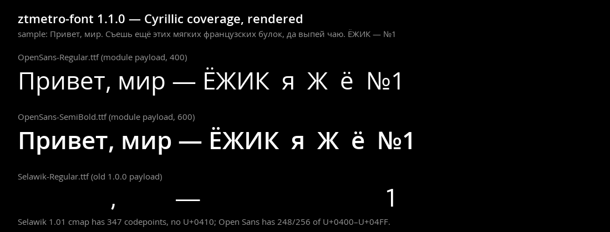

# ztmetro-font 1.1.0 — Open Sans system sans-serif on LineageOS 23.2 (Android 16)

Evidence for the payload swap **Selawik 1.01 → Open Sans 3.003** in the Magisk module
`ztmetro-font`, built by `repo/scripts/build-font-module.sh` on `hermes-ubuntu`
(`~/ztux/font2`) with no Android SDK and no adb. Status labels: `[F]` verified from a
file/cmap/build in this task; `[E]` engineering inference from cited sources; `[?]`
not verified (needs the device, which this task was not allowed to touch).

- **Zip:** `repo/artifacts/ztmetro-font-1.1.0.zip`
  **sha256 `33d643465ea5dc7c76f838bb598e9104b12838944a02a25132867f6cacab92fa`**,
  **700774 bytes**, 16 entries. Identical hash from the macOS build and the
  `hermes-ubuntu` build (reproducible: sorted entries, fixed mtimes).
- Module `id=ztmetro-font`, **version 1.1.0 / versionCode 10100**, author `xtwxllpxss`.
  The old `artifacts/ztmetro-font-1.0.0.zip` (Selawik) is left in place as history and
  is superseded by this one.
- Build log: [`build-ubuntu.log`](build-ubuntu.log). Installer dry run:
  [`install-dryrun-ubuntu.log`](install-dryrun-ubuntu.log).

## 1. Why Open Sans, and what it fixes

The 1.0.0 module set `sans-serif` to Selawik 1.01: OFL, metric-compatible with Segoe
UI — but **Latin-only, 347 codepoints, no Cyrillic**. On a Russian UI every Cyrillic
glyph missed Selawik and per-glyph fallback picked the next family with the glyph
(Noto CJK in AOSP 16), so Russian text was a different design and weight from the
Latin text around it.

Open Sans was designed by **Steve Matteson**, the designer of **Segoe UI**; it is a
humanist sans in the same class, SIL OFL 1.1, and has full **Cyrillic, Greek and real
italics**. `design/tokens/ztmetro.tokens.json` already lists it as the free fallback
after Segoe UI and Selawik in every family stack (`display`, `body`, `light`,
`semibold`), so this change moves Android's `sans-serif` to the family the tokens
already name. No Segoe UI file is shipped.

After 1.1.0, Russian and Latin UI text are the **same family at the same weight**,
instead of Selawik Latin + Noto Cyrillic. See the rendered proof:



The Selawik row shows what 1.0.0 produced for the same string: only the comma, dash
and digit have glyphs.

## 2. Font provenance

Official upstream statics from <https://github.com/googlefonts/opensans>, path
`fonts/ttf/`, pinned to commit
**`6cbc400d4855abee59d85c4ed871d510399bce7b`** (2026-11-10):
`https://raw.githubusercontent.com/googlefonts/opensans/6cbc400d4855abee59d85c4ed871d510399bce7b/fonts/ttf/<file>`.
License text (`OFL.txt` at the same commit) is stored as
[`repo/fonts/opensans/LICENSE.txt`](../../fonts/opensans/LICENSE.txt); the zip carries
`OpenSans-OFL.txt` and `OpenSans-ATTRIBUTION.md`.

| repo file | bytes | sha256 | PS name | usWeightClass |
|---|---|---|---|---|
| `fonts/opensans/OpenSans-Light.ttf` | 143788 | `3472097ec4d9e57228cbfad3c9911e53923664d3df86568d0b05d674399e034e` | OpenSans-Light | 300 |
| `fonts/opensans/OpenSans-LightItalic.ttf` | 151216 | `548dc557bcef26267d16f1afaf0770814a329c9f04a0168d396ca9d1ceafb16f` | OpenSans-LightItalic | 300 |
| `fonts/opensans/OpenSans-Regular.ttf` | 147528 | `c53aceea2dcf5b4098099c0c4d0a061d17e178a049317b42a422b1a9f7f8eb59` | OpenSans-Regular | 400 |
| `fonts/opensans/OpenSans-Italic.ttf` | 153256 | `93bc1bb6abf4e6b7c75d7131714061d5b57cc478abcabe4cb3519bb38fb917aa` | OpenSans-Italic | 400 |
| `fonts/opensans/OpenSans-SemiBold.ttf` | 150592 | `4a413711684a9dd564ef0f1c10cb62b5d9f7eb6df2cff962f5341a6ecd5f64ae` | OpenSans-SemiBold | 600 |
| `fonts/opensans/OpenSans-SemiBoldItalic.ttf` | 157560 | `c646a9aefc0e964f66487260639e375685328a6280856faea3e012c43fe9c56d` | OpenSans-SemiBoldItalic | 600 |
| `fonts/opensans/OpenSans-Bold.ttf` | 147264 | `27da758f4dcac9a65abe914c13b463b42982b9909bc65713424099f4810bd1e6` | OpenSans-Bold | 700 |
| `fonts/opensans/OpenSans-BoldItalic.ttf` | 153308 | `d672a770037104b6af45e1336b3d3c1729c8aea940f81e010f5a8a7319c29a21` | OpenSans-BoldItalic | 700 |

Verified per file `[F]` with
[`scripts/font_coverage.py`](scripts/font_coverage.py) (a minimal sfnt/cmap parser
written for this task because fontTools is absent on both hosts; no pip, no network):

- genuine **static TrueType**: sfnt magic `00 01 00 00`, `glyf`/`loca` present,
  **no `fvar` table**, `fsType = 0` (installable embedding); 1150 glyphs in upright
  faces, 1162 in italics;
- name table: family `Open Sans`, version string `Version 3.003; ttfautohint (v1.8.4)`,
  copyright `Copyright 2020 The Open Sans Project Authors`;
- `SHA256SUMS` in `repo/fonts/opensans/` matches the downloaded bytes and is enforced
  by the build; the installer re-checks magic bytes on-device.

Full machine-readable output: [`coverage.json`](coverage.json).

## 3. Cyrillic coverage (measured, not assumed)

`cmap` **version 0** in every face. Each face has two Unicode **format-4** subtables
(platform 0/encoding 3 and platform 3/encoding 1), both with the same coverage.

| metric | upright faces (Light/Regular/SemiBold/Bold) | italics |
|---|---|---|
| Unicode codepoints | **969** | **972** (adds U+0326–U+0328) |
| Cyrillic block U+0400–U+04FF | **248 / 256** | **248 / 256** |
| Greek block U+0370–U+03FF | 75 | 75 |
| Latin basic U+0020–U+007E | 95 (all) | 95 (all) |

Explicitly required codepoints, checked in every one of the eight files `[F]`:

| codepoint | character | present |
|---|---|---|
| U+0410 | А | **yes** |
| U+0430 | а | **yes** |
| U+0451 | ё | **yes** |
| U+0416 | Ж | **yes** |
| U+044F | я | **yes** |

Also present: Ё U+0401, й U+0439, ъ U+044A, ы U+044B, э U+044D, ю U+044E, № U+2116,
« U+00AB, » U+00BB, — U+2014, … U+2026. The eight missing Cyrillic codepoints are
U+045D (Ukrainian і with grave), U+045E (Belarusian ў), U+045F (Macedonian џ) and the
combining marks U+0483–U+0487; **none is used by Russian**, so the Russian alphabet
is complete. The build fails if any shipped upright face loses one of the five
required codepoints.

## 4. Payload, fragment and weight mapping

The module no longer renames fonts: it ships the eight upstream names unchanged, and
`fonts.fragment` references them directly. `sans-serif` remains 20 static entries
(10 weights × normal/italic), no `<axis>`.

| Android weight | normal | italic |
|---|---|---|
| 100, 200, 300, **350** | `OpenSans-Light.ttf` | `OpenSans-LightItalic.ttf` |
| 400 | `OpenSans-Regular.ttf` | `OpenSans-Italic.ttf` |
| 500, 600 | `OpenSans-SemiBold.ttf` | `OpenSans-SemiBoldItalic.ttf` |
| 700, 800, 900 | `OpenSans-Bold.ttf` | `OpenSans-BoldItalic.ttf` |

- **500 → SemiBold** is kept from the Selawik module: Android's `sans-serif-medium`
  is 500, and the ztmetro semibold is 600, so 500/600 share one face (the WP
  page-title look).
- **350 → Light** (not Regular): Open Sans has no 350 face. The token policy already
  maps semilight/350 to `sans-serif-light`/300, and Light keeps 100–350 a continuous
  light range; Regular at 350 would be visually identical to 400 and collapse the
  ramp.
- **Italics are real now.** Selawik 1.01 had no italic and the 1.0.0 fragment pointed
  `style="italic"` at upright files. Open Sans supplies Light/Regular/SemiBold/Bold
  italics, so italic text is slanted and stays in the family.

Everything outside the one `<family name="sans-serif">` block is preserved
byte-for-byte: emoji, CJK, monospace, serif, `sans-serif-condensed`, symbols and all
aliases (`sans-serif-light`, `sans-serif-medium`, …) are untouched and re-point at the
rewritten family automatically.

## 5. Build and validation evidence (hermes-ubuntu, no device)

`bash scripts/build-font-module.sh` on `hermes-ubuntu` `[F]`:

1. eight payload files: TTF magic + `SHA256SUMS`;
2. `customize.sh`/`rewrite-fonts.sh` parse under `sh -n`; no host paths in module
   sources;
3. `fonts.fragment` is well-formed XML, exactly **20** entries, **8** distinct faces,
   every named file shipped, no `<axis>`;
4. cmap assertion on the four upright faces (`969` codepoints, cmap v0, 248/256
   Cyrillic, required five present);
5. splice replayed on the checked-in AOSP 16 fixtures and parsed with Python;
6. stage + zip + archive layout validation.

Output ([`build-ubuntu.log`](build-ubuntu.log)):

```
module zip : .../artifacts/ztmetro-font-1.1.0.zip
sha256     : 33d643465ea5dc7c76f838bb598e9104b12838944a02a25132867f6cacab92fa
size       : 700774 bytes
entries    : 16 files (module root + system/fonts)
```

Zip layout `[F]` ([`module-filelist.txt`](module-filelist.txt)): `module.prop`,
`customize.sh`, `rewrite-fonts.sh`, `verify-xml.awk`, `fonts.fragment`, `README.md`,
`OpenSans-OFL.txt`, `OpenSans-ATTRIBUTION.md`, and `system/fonts/OpenSans-*.ttf` (8).
No `system/etc/*.xml` is baked in; the config is generated on-device from the live ROM
(unchanged design of 1.0.0).

**Splice on the real AOSP 16 fixtures** `[F]`
([`transforms/`](transforms/)):

| fixture | before sans-serif | after | preserved |
|---|---|---|---|
| `fonts.xml.aosp16` | 18 variable entries, 54 `<axis>` | 20 static Open Sans, 0 axis | 160 families, 24 aliases |
| `font_fallback.aosp16-roboto.xml` | 1 variable entry, 1 axis | 20 static Open Sans, 0 axis | 3 families, 6 aliases |

`rewrite-fonts.sh` additionally proves the rest of each file is unchanged: it re-runs
the splice with the family replaced by a marker on input and output and requires the
two stripped results to be byte-identical; family/alias/font/axis counts must also
match the arithmetic. A malformed fragment, an unexpected `sans-serif` shape, a
missing payload file or any count drift aborts the install.

**`customize.sh` dry run** `[F]` ([`install-dryrun-ubuntu.log`](install-dryrun-ubuntu.log),
harness [`scripts/dry-run-install.sh`](scripts/dry-run-install.sh)): the installer was
sourced under Ubuntu `dash` with `MODPATH` staged like the zip, the three absolute
`/system` probes redirected to a temp tree holding the AOSP 16 fixtures, and Magisk's
`ui_print`/`abort`/`set_perm*` stubbed. It exited 0, wrote both overlay configs, each
with 20 Open Sans entries, no axis in `sans-serif`, family/alias counts unchanged, and
every referenced TTF present. This is the exact validation path the device takes,
modulo Magisk's own mount — no reason for it to reject the XML.

## 6. What changes for Russian text, and what still differs

**Changes `[E]`** (mechanism `[F]`: `SystemFonts` reads `font_fallback.xml`; the
module rewrites it and `fonts.xml`; Open Sans has the glyphs):

- Russian text in framework `TextView`/buttons, Settings, SystemUI (status bar, QS,
  notifications, keyguard), Compose `FontFamily.Default`, and Skia-native text now
  renders in **Open Sans**, the same design and weight as the Latin text — no more
  Selawik/Noto mixing.
- Cyrillic italic (rare in the UI, but present in some apps) is a real italic.
- Weight 350 gets a real face (Light) instead of Semilight; 500 stays SemiBold.

**Still differs, explicitly:**

- **Telegram** bundles and explicitly loads its own faces
  (`rmedium.ttf`, `rextrabold.ttf`, `rmediumitalic.ttf`, `ritalic.ttf`, `rmono.ttf`,
  `mw_bold.ttf`, … via `Typeface.createFromAsset`/`AndroidUtilities.getTypeface`).
  Its branded headers, medium/extrabold/italic/mono text **stay Telegram's fonts** and
  do not become Open Sans. Ordinary message text drawn with the platform default may
  pick up Open Sans, but that is per-view and was not verified on-device `[?]`. The
  Telegram APK was not inspected here either (CDN download was blocked in the earlier
  font task); this comes from the Telegram source tree `[F]` for the asset list and
  `[E]` for per-view effect.
- **Web content** is a partial case: WebView/Chromium generic `sans-serif` resolves
  through the Android font manager and may follow the module `[E]`, but any page that
  ships a **webfont** (`@font-face`, Google Fonts, most modern sites) uses that font
  and is unaffected. Chromium's exact generic-family behaviour was **not**
  device-tested `[?]`. The same applies to apps that bundle fonts (Flutter, React
  Native, games, many chat/reader apps) and to icon fonts.
- Monospace, serif, `sans-serif-condensed`, emoji and CJK stay stock.
- A `/product/etc/fonts_customization.xml` that redefines a named `sans-serif` family
  would override the module; check it on the device `[?]`.

**One regression to accept:** Selawik was metric-compatible with Segoe UI; **Open Sans
is not**. Latin advance widths change slightly, so text can reflow by a word or a few
pixels at the same `sp`. This is the cost of a family that actually has Cyrillic; no
layout constant in the ROM or tokens changes. Glyph shapes also differ from Segoe UI
(e.g. `g`, `l`, digits) — Open Sans is Segoe-UI-class, not a clone.

## 7. Install / rollback for the lead (adb is the lead's)

Install (from the `android-ux-research` workspace root):

```sh
adb push repo/artifacts/ztmetro-font-1.1.0.zip /sdcard/
adb shell su -c 'magisk --install-module /sdcard/ztmetro-font-1.1.0.zip'
adb reboot
```

This is an upgrade of the installed `ztmetro-font` 1.0.0; Magisk replaces the module
directory, including the old Selawik files. Watch the installer's `ui_print` lines:
it prints `installed: 8 Open Sans faces` and aborts without installing on any
validation failure.

Verify after boot:

```sh
adb shell su -c 'grep -c OpenSans- /system/etc/font_fallback.xml'   # 20
adb shell su -c 'grep -c OpenSans- /system/etc/fonts.xml'           # 20
adb shell su -c 'ls -l /system/fonts/OpenSans-*.ttf'                # 8 files
adb logcat -d | grep -i 'Loading font config'                       # names font_fallback.xml
adb shell am force-stop com.android.settings
adb shell am start -a android.settings.SETTINGS
adb exec-out screencap -p > /tmp/settings-ru.png                    # Russian UI = Open Sans
```

Rollback (non-destructive; `/system` was never written):

```sh
adb shell su -c 'touch /data/adb/modules/ztmetro-font/disable' && adb reboot
# or remove it entirely:
adb shell su -c 'magisk --remove-modules' && adb reboot
```

Recovery without adb: Magisk safe mode (hold **Vol−** during boot), or delete
`/data/adb/modules/ztmetro-font/` in recovery. The stock config files are untouched on
disk.

## 8. What was not verified (and any failures)

- **No device run** `[?]`: adb belongs to the lead and this task was explicitly
  forbidden from using it. Boot, actual glyph rasterisation by Android, reflow and
  recovery are reasoned/validated, not seen.
- **fontTools is not installed** on macOS or `hermes-ubuntu` and installing it needs
  network; per instructions I wrote the minimal cmap parser instead. No pip was used.
- **Telegram APK** was not inspected (same CDN block as the previous font task);
  source-level asset evidence only. WebView generic-font resolution not device-tested.
- The LineageOS build's exact live `font_fallback.xml` is still not published; the
  installer reads it on-device and refuses unknown shapes, and the AOSP 16 fixtures
  reproduce the r3 shapes. This affects fixture fidelity, not the install path.
- No commit/push was made, per instructions.
