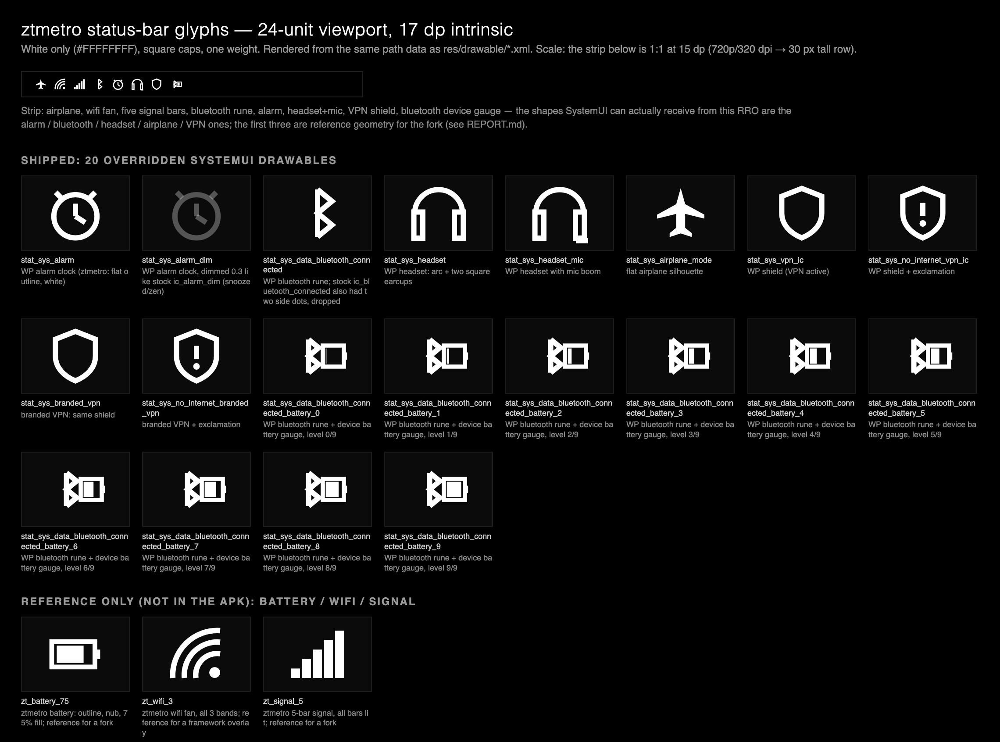

# Status-bar glyphs — SystemUI RRO: inventory, build, verification

Scope: `repo/overlay/statusbar-icons/**` + `repo/scripts/build-overlay-statusbar-icons.sh`.
Built on `hermes-ubuntu` (`~/ztux/icons`) with `~/android-sdk` build-tools 36.0.0 and
`~/android-jdk`, signed with the project throwaway key (`CN=ztmetro overlay`).
No device/adb work in this task — runtime behaviour on the phone is unverified until
the lead installs and restarts SystemUI.

Source of truth for every name and line:
`LineageOS/android_frameworks_base` @ `797e43244b96c6a0dff5c81b21c4d4be665b082e`
(`lineage-23.2`), sparse checkout `~/ztux/status/tree`
(`packages/SystemUI/{res,src,aconfig}`, `packages/SettingsLib/{res,aconfig}`,
`core/res/res/values`). Raw quotes: [`name-verification.txt`](name-verification.txt).



## 1. Artifact

| | |
|---|---|
| APK | `repo/evidence/statusbar-icons/ztmetro-statusbar-icons-rro.apk` (26 827 B) |
| sha256 | `f86ed13c8559f9a434da4f4b36eaa39a3542679f8b684f55511c18b09193a9db` |
| package | `org.ztos.overlay.statusbaricons`, versionCode 1, `hasCode=false` |
| target | `com.android.systemui`, priority 30, `isStatic=false` |
| signer | `CN=ztmetro overlay (throwaway)`, cert SHA-256 `16e91082631bef535eba7ebe3a62ff3b01f47b95acd1415db151c92addcb8d3e` |
| entries | exactly 20 × `drawable/*`, no `values/`, checked by the build script |

`apksigner verify` clean, `aapt2 dump badging`:
`overlay: targetPackage='com.android.systemui' priority='30' isStatic='false'`.
Transcript: [`build-log.txt`](build-log.txt); resource table:
[`aapt2-dump-resources.txt`](aapt2-dump-resources.txt); compiled vector attributes
(17 dp, 24 viewport, butt/miter, white) in
[`aapt2-dump-xmltree.txt`](aapt2-dump-xmltree.txt). Colours in the sources are only
`#FFFFFFFF` (23 filled paths) and `#00000000` (transparent fill under the 55 stroked
paths) — no tint, no gradient, no alpha except the deliberate 0.3 dim alarm.

## 2. Inventory — what the status bar actually reads

The status bar root is Compose (`StatusBarRoot.kt:339`), but the **system** status
icons on 23.2 are still rendered through the legacy View/`StatusBarIconController`
branch unless an aconfig flag pair is on:

```
if (SystemStatusIconsInCompose.isEnabled) { ... } else {
    StatusIconContainer + StatusBarIconController + DarkIconManager
}
```
`SystemStatusIconsInCompose.isEnabled = Flags.statusBarSystemStatusIconsInCompose()
&& NewStatusBarIcons.isEnabled` (`SystemStatusIconsInCompose.kt:37`); the flag has
no build-time default (`packages/SystemUI/aconfig/systemui.aconfig:372`), and
`new_status_bar_icons` (`packages/SettingsLib/aconfig/settingslib.aconfig:5`) is the
same kind of release-off flag. **Legacy is the default**, so the names below are
live.

| resource | definition (SystemUI) | consumer | pipeline | shipped |
|---|---|---|---|---|
| `stat_sys_alarm` | `res/drawable/stat_sys_alarm.xml:18-21` (inset → `ic_alarm`) | `PhoneStatusBarPolicy.java:296` | legacy | ✔ |
| `stat_sys_alarm_dim` | `stat_sys_alarm_dim.xml:16-19` (inset → `ic_alarm_dim`, fillAlpha 0.3) | `PhoneStatusBarPolicy.java:433-434` | legacy | ✔ |
| `stat_sys_data_bluetooth_connected` | `...:16-17` (inset → `ic_bluetooth_connected`) | `PhoneStatusBarPolicy.java:496` | legacy | ✔ |
| `stat_sys_data_bluetooth_connected_battery_0..9` | `...battery_N.xml:19-20` (vector 20×17 dp) | `PhoneStatusBarPolicy.java:506-524` | legacy | ✔ (10) |
| `stat_sys_headset` | `...:16-19` (inset → `ic_headset`) | `PhoneStatusBarPolicy.java:783-784` | legacy | ✔ |
| `stat_sys_headset_mic` | `...:16-19` (inset → `ic_headset_mic`) | same | legacy | ✔ |
| `stat_sys_airplane_mode` | `...:19-20` (inset → `@*android:drawable/ic_qs_airplane`) | `StatusBarSignalPolicy.java:167`, `NetworkControllerImpl.java:727,1097,1273` | both (legacy drawable; new path uses framework `ic_qs_airplane`) | ✔ |
| `stat_sys_vpn_ic`, `stat_sys_no_internet_vpn_ic`, `stat_sys_branded_vpn`, `stat_sys_no_internet_branded_vpn` | `stat_sys_vpn_ic.xml:19-20` etc. | `StatusBarSignalPolicy.java:118`; `VpnIconViewModel.kt:61-69` | **both** | ✔ (4) |

`PhoneStatusBarPolicy` is Dagger-injected into the live controller
(`CentralSurfacesImpl.java:375,693`), so the legacy consumers above are not dead code.

### Not SystemUI drawables — deliberately not shipped

* **battery** — no `stat_sys_battery*` in `packages/SystemUI/res/drawable*/` at all.
  Battery is Canvas code: `battery/AccessorizedBatteryDrawable.kt:49`
  (`DrawableWrapper(ThemedBatteryDrawable(...))`, constructed in
  `battery/BatteryMeterView.java:77,123`); the new path draws it in Compose
  (`pipeline/battery/shared/ui/BatteryFrame.kt`). The `stat_sys_battery_*` PNGs that
  exist under `core/res/res/drawable-*/` are framework leftovers, referenced only by
  `core/res/res/values/symbols.xml:2151-2153`; SystemUI never asks for them.
* **wifi** — `WifiIcon.Visible` carries an id from `WifiIcons.java:34-53`:
  `com.android.internal.R.drawable.ic_wifi_signal_0..4` (flag off) or
  `com.android.settingslib.R.drawable.ic_wifi_0..3` (flag on). No
  `stat_sys_wifi_signal_*` exists anywhere in 23.2.
* **mobile signal** — SettingsLib `SignalDrawable` Canvas
  (`connectivity/MobileSignalController.java:234-248`), or Compose
  `MobileSignalIcon` (`pipeline/mobile/ui/compose/MobileIcon.kt:183`). No
  `stat_sys_signal_*` in SystemUI.

So a SystemUI resource-only overlay **cannot** make battery, wifi or signal look like
WP. That is why this APK has 20 entries and not 30+; shipping `stat_sys_battery_*`
names would be a silent no-op (they do not exist in the target).

### SAB chip/background

No chip background is drawn behind the system-icon row in either pipeline.
`statusbar_battery_chip_bg.xml` belongs to the battery *status event chip*
(`statusbar/events/ui/view/BatteryStatusEventComposeChip.kt:100`), not to the
status-bar icons — nothing to override, so nothing was.

## 3. The glyphs

All vectors: 17 dp intrinsic, 24-unit viewport, `#FFFFFFFF` only, square caps/joins,
one weight; stock 2.5 dp insets folded into the path box so optical size stays close
to the originals. `stat_sys_alarm_dim` is the same white at 0.3 (stock
`ic_alarm_dim` uses `fillAlpha 0.3`). Bluetooth device-battery variants keep the
10-step gauge, redrawn as a narrow cell + nub instead of the Material rune+battery.

Geometry source: `ztmetro.c` `draw_signal()` (5 bars, pitch w/4.8, bar 0.8 pitch,
heights 0.2–1.0 h, unlit 0.3 alpha), `draw_wifi()` (quarter fan, 3×0.115 s bands,
outer edges 1/0.756/0.513 s, corner dot 0.115 s) and `status_row()` (battery
outline + terminal nub + inner fill). Those three are in `fallback/drawable/` as
reference only (not compiled): `zt_battery_75.xml`, `zt_wifi_3.xml`,
`zt_signal_5.xml`. Note: the brief said four-bar signal, but `draw_signal()` in
`ztmetro.c` draws **five** bars — the reference glyph follows the C source.

Every overridden XML is self-contained (literal colours, no `@drawable/…`
references), because idmap2 only rewrites references that exist in the target
package (`docs/10b-overlay-and-hook-facts.md` §3a).

## 4. Expected before / after

SystemUI restart, home status bar (order depends on slots):

| slot | before (Material) | after |
|---|---|---|
| alarm | filled twin-bell clock with thick ring | thin white ring, two diagonal bells, two hands, 0.3 alpha when dimmed |
| bluetooth | rune + two side dots | plain rune, no dots; with a connected device's battery: rune + narrow 10-step cell |
| headset | Material headphone, rounded cups | arc + two square earcups; mic variant adds boom + dot |
| airplane | Material plane | flat silhouette |
| VPN | Material keyed-circle | white shield; no-internet variant adds `!` |
| battery / wifi / signal | Material | **unchanged** — see §5 |

## 5. If the live pipeline does not read them — the fallback

1. **Confirm the branch first** (lead):
   `adb shell su -c 'cmd device_config get systemui status_bar_system_status_icons_in_compose'`
   and `... new_status_bar_icons`. `null`/false → legacy, this RRO is live.
2. **Compose branch on** (`true`): alarm/bluetooth/airplane switch to `ic_alarm`
   (`NextAlarmIconViewModel.kt:66`), `ic_bluetooth_connected`
   (`BluetoothIconViewModel.kt:66`) and framework `ic_qs_airplane`
   (`AirplaneModeIconViewModel.kt:72`). The same RRO can additionally override
   `drawable/ic_alarm` and `drawable/ic_bluetooth_connected` — both exist in
   SystemUI — but `ic_alarm` is also the QS AlarmTile and volume-slider icon, so
   that is a broader shape change; airplane needs a **framework** RRO
   (`ic_qs_airplane`, target `android`) or a fork. VPN keeps `stat_sys_vpn_ic`.
3. **Wifi, cheapest path**: a framework RRO (target `android`) over the existing
   vectors `core/res/res/drawable/ic_wifi_signal_0..4.xml` — no code, if the
   new-icons flag is off. Flag on → SettingsLib `ic_wifi_0..3`; probe the SystemUI
   APK's table (`aapt2 dump resources SystemUI.apk | grep ic_wifi`) before shipping
   that name.
4. **Battery and mobile signal need a fork** (there is no drawable to overlay):
   battery — replace the draw in `AccessorizedBatteryDrawable`/`ThemedBatteryDrawable`
   (legacy) and `BatteryFrame.kt` (Compose); signal — replace `SignalDrawable.draw`
   (SettingsLib) or `MobileSignalIcon`. Use the `fallback/` geometry: battery
   outline 1.95 × cell with nub and inner fill; five bars 0.2–1.0 h, unlit 0.3.

## 6. Deploy / verify (lead, device owner)

The overlay may override any SystemUI resource only as a **preinstalled** RRO
(no `<overlayable>` in SystemUI). Use the existing Magisk module path:

```sh
APK=repo/evidence/statusbar-icons/ztmetro-statusbar-icons-rro.apk
adb push "$APK" /data/local/tmp/
adb shell su -c 'mkdir -p /data/adb/modules/ztmetro-overlays/system/product/overlay \
  && cp /data/local/tmp/ztmetro-statusbar-icons-rro.apk \
        /data/adb/modules/ztmetro-overlays/system/product/overlay/ \
  && chmod 644 /data/adb/modules/ztmetro-overlays/system/product/overlay/ztmetro-statusbar-icons-rro.apk'
# the module mount is applied at boot; once /product/overlay is live:
adb shell su -c 'cmd overlay list --user 0 | grep statusbaricons'
adb shell su -c 'cmd overlay enable --user 0 org.ztos.overlay.statusbaricons'
adb shell su -c 'cmd overlay dump org.ztos.overlay.statusbaricons | head -30'
adb shell su -c 'killall com.android.systemui'
```

Persist: add `org.ztos.overlay.statusbaricons` to the package loop in
`repo/modules/ztmetro-overlays/service.sh:19`.

Checks after the SystemUI restart: alarm set → white ring clock; Bluetooth on and
connected → plain rune (device battery → rune+gauge); wired headset → arc+cups;
airplane mode → flat plane; VPN on → shield. If those five still show Material
shapes, the overlay is not mapping (check `cmd overlay list` and that the APK is on
`/product/overlay`, not user-installed) or the Compose branch is on — then run §5.1.

Rollback: `adb shell su -c 'cmd overlay disable org.ztos.overlay.statusbaricons'`
and remove the APK from the module directory.

## 7. What is verified, what is not

Verified here: every name exists in the lineage-23.2 SystemUI tree at the quoted
line; the built APK contains exactly those 20 drawables
(`aapt2 dump resources`, entryCount=20, no value resources); signature verifies;
the vector path data parses and renders (the preview PNG is produced from the same
path data in a browser SVG engine, square-cap Metro shapes as intended).

Not verified here (no adb): idmap creation on the device, and the pixels in the
live status bar. The build host had no `aapt2` for the device APK, so the flag
probe in §5.1 has to run on the lead's side.
